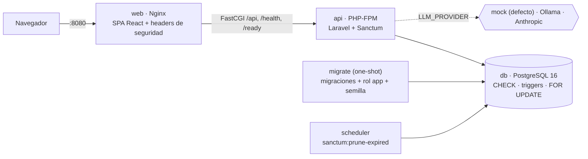
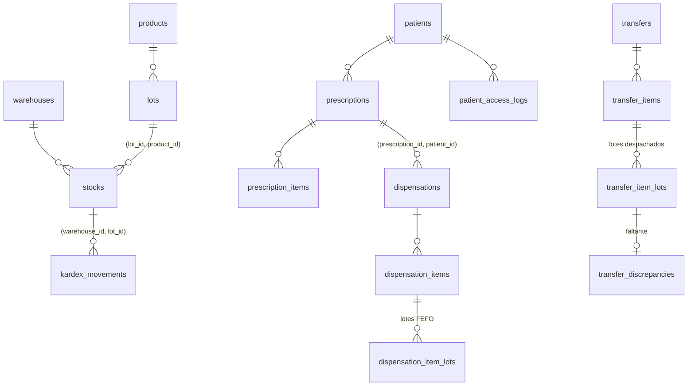

# FARTMAR IPS — Dispensación, inventario por lote y traslados

Sistema para dispensar medicamentos contra prescripción, controlar el inventario por bodega + producto + lote y trasladar
entre bodegas, con kardex inmutable y protección de los datos del paciente. Prueba técnica Full Stack Senior:
Laravel 13 (PHP 8.4) + PostgreSQL 16 + React 19/TypeScript + Docker. Todos los datos son **100 % sintéticos**.



## Contenido

1. [Ejecutar en un comando](#ejecutar-en-un-comando)
2. [Pruebas, linters y evaluación del asistente](#pruebas-linters-y-evaluación-del-asistente)
3. [Arquitectura](#arquitectura)
4. [Reglas de negocio: dónde se defienden y qué las prueba](#reglas-de-negocio-dónde-se-defienden-y-qué-las-prueba)
5. [Decisiones de diseño y trade-offs](#decisiones-de-diseño-y-trade-offs)
6. [Supuestos principales](#supuestos-principales)
7. [Asistente IA](#asistente-ia)
8. [Seguridad y privacidad](#seguridad-y-privacidad)
9. [Librerías](#librerías)
10. [Qué quedó fuera y por qué](#qué-quedó-fuera-y-por-qué)
11. [Documentación](#documentación)

## Ejecutar en un comando

Requisito: Docker con Compose v2. No hace falta PHP, Composer ni Node en el host para la demo (`make test` y `make lint`
sí necesitan Node 24 en el host, ver [Pruebas](#pruebas-linters-y-evaluación-del-asistente)).

```bash
cp .env.example .env && docker compose up -d --build --wait      # equivale a: make up
```

Windows (PowerShell, sin `make`):

```powershell
Copy-Item .env.example .env; docker compose up -d --build --wait  # o: .\make.ps1 up
```

Abrir **http://localhost:8080**. El servicio `migrate` aplica migraciones, crea el rol de BD de la aplicación y siembra los
datos demo; `--wait` vuelve cuando todo está sano. Desde cero tarda unos minutos (construcción de imágenes).

| Servicio | Qué es | Puerto en el host |
|---|---|---|
| `web` | Nginx: SPA + proxy FastCGI de `/api`, `/health`, `/ready` | **8080** |
| `api` | PHP-FPM (Laravel), sin puerto publicado | — |
| `db` | PostgreSQL 16 | **127.0.0.1:55432** (solo local) |
| `migrate` | One-shot: migraciones, `db:provision-app-role`, semilla | — |
| `scheduler` | `schedule:work` (poda de tokens vencidos) | — |
| Vite (solo desarrollo, en el host) | `make frontend-dev`, proxy `/api` → 8080 | 5173 |

### Usuarios demo

Contraseña de todos: **`password`** (solo demo; ver `docs/modelo-datos.md`).

| Correo | Rol | Para qué sirve en la demo |
|---|---|---|
| `auxiliar@fartmar.test` | `auxiliar_farmacia` | Dispensar, crear/despachar/recibir traslados |
| `regente@fartmar.test` | `regente_farmacia` | Aprobar traslados, autorizar controlados, ajustes, discrepancias |
| `regente2@fartmar.test` | `regente_farmacia` | Segundo regente para RN-05 (autoriza lo que creó el otro) y RN-08 |
| `medico@fartmar.test` | `medico` | Crear prescripciones, consultar pacientes |
| `auditor@fartmar.test` | `auditor` | Solo lectura; pacientes enmascarados |
| `admin@fartmar.test` | `admin` | Usuarios; los catálogos se cargan por semilla, sin API de escritura (S-119). No ve pacientes (S-68) |

Pacientes sintéticos: CC `9900000001` (Ana), `9900000002` (Carlos), `9900000003` (Lucía, con morfina de control especial).
Hay un lote vencido (`L-ACE-2401`), lotes que vencen en < 30 días y un traslado sembrado con una observación maliciosa
para probar la inyección de instrucciones.

> **Solo demo:** `ALLOW_GENERATED_KEYS=true` genera `APP_KEY` y `PATIENT_HASH_KEY` una vez en el volumen `app_keys`, y
> `SEED_DEMO_DATA=true` siembra usuarios con clave conocida. En producción ambas van en `false` y las llaves salen del
> gestor de secretos; `scripts/deploy.sh production` aborta si no es así (S-102, S-115). Detalle en `docs/DEPLOY.md`.

### Desarrollo

```bash
make dev            # .\make.ps1 dev   — mismo compose + docker-compose.dev.yml (código montado, debug, BD propia)
make frontend-install && make frontend-dev   # Vite en http://localhost:5173 (Node 24 en el host)
make fresh          # migrate:fresh --seed en la BD de desarrollo
make down | make reset | make logs | make shell | make backup | make restore FILE=backups/x.dump
```

`make up` (tipo producción) y `make dev` usan volúmenes de BD distintos (`db_data` / `db_data_dev`) porque cada uno tiene
sus propias llaves de cifrado (S-99).

## Pruebas, linters y evaluación del asistente

| Comando (`make …` o `.\make.ps1 …`) | Qué corre |
|---|---|
| `test` | Pest (backend, contra PostgreSQL `fartmar_test`, incluye concurrencia) + Vitest (frontend, **en el host**) |
| `test-concurrency` | Solo las 20 pruebas de concurrencia real (procesos PHP en paralelo; ~2 min) |
| `lint` | Pint `--test`, Larastan (nivel 6) + ESLint y `tsc` (**en el host**) |
| `eval` | Evaluación del asistente IA: `php artisan assistant:eval --provider=mock` (18 casos, umbral 90 %) |

`test`, `lint`, `eval` y `fresh` levantan el entorno de desarrollo solos si la API en ejecución no es la de desarrollo.
La parte de frontend de `test` y `lint` corre con `npm` en el host: requiere **Node 24** y haber ejecutado una vez
`make frontend-install` (`npm ci`). La demo no lo necesita.

El eval también corre sobre el stack de un comando, sin entorno de desarrollo ni Node en el host:

```bash
docker compose exec -T api php artisan assistant:eval --provider=mock   # 18/18, también después de la demo
```

Las pruebas nunca usan SQLite: CHECK, triggers y `FOR UPDATE` son justo lo que se prueba (S-02). Las de concurrencia no
usan `RefreshDatabase` (una transacción envolvente ocultaría la carrera): lanzan procesos PHP reales con su propia
conexión, los sueltan a la vez con una barrera de `pg_advisory_lock` y verifican que el kardex cuadre
(`backend/tests/Support/ConcurrentDispenser.php`).

CI (`.github/workflows/ci.yml`): lint + auditorías → Pest/Vitest/eval → imágenes + Trivy → staging simulado en el runner
(smoke, no-root, `TRUNCATE` denegado, respaldo/restauración) → publicación en GHCR → producción simulada con aprobación.

## Arquitectura

```
backend/app/
├── Domain/                    # lógica de negocio (los controladores solo validan, autorizan y delegan)
│   ├── Inventory/             # FefoAllocator (puro), StockService (único que escribe stocks), KardexService,
│   │                          # AdjustmentService, AlertService, BusinessDate ("hoy" en Bogotá)
│   ├── Dispensing/            # DispenseService (crear/autorizar/rechazar/preview), IdempotencyGuard
│   ├── Transfers/             # TransferStateMachine, TransferService, TransferActions (allowed_actions)
│   ├── Patients/              # PatientMasker, PatientAccessLogger, DocumentHasher (HMAC), PatientFinder
│   ├── Assistant/             # LlmProvider + Providers/, ToolRegistry + Tools/, QuestionGuard, OutputGuard
│   └── Exceptions/            # errores de negocio con código → JSON uniforme (Http/ApiErrorRenderer.php)
├── Http/{Controllers,Requests,Resources,Middleware}
├── Policies/                  # toda la autorización por rol (sin if de roles en controladores; ArchitectureTest)
└── Logging/RedactSensitiveData.php
backend/database/migrations/   # 24 migraciones: CHECK, FK compuestas, triggers
frontend/src/                  # api/ (cliente único, errores en español), auth/, features/<módulo>/
docker/                        # nginx, php-fpm, entrypoints, healthchecks
scripts/                       # backup.sh, restore.sh, smoke-test.sh, deploy.sh
```

Errores de negocio: `{ "error": { "code": "STOCK_INSUFICIENTE", "message": "…", "details": {} } }` con 403/409/422;
cada respuesta trae `X-Correlation-Id`, que también queda en logs, kardex y bitácoras.

### Modelo de datos (resumen)



Diagrama completo, defensas por tabla y lo que la BD **no** garantiza: [`docs/modelo-datos.md`](docs/modelo-datos.md).

## Reglas de negocio: dónde se defienden y qué las prueba

Rutas relativas a `backend/`. "BD" = defensa en PostgreSQL además del código.

| Regla | Código | BD | Pruebas principales |
|---|---|---|---|
| **RN-01** Lote vencido nunca sale | `StockService::decrease` (salidas), `StockService::fefoQuery` (`expires_at >= hoy`), `BusinessDate` | triggers `dispensation_item_lots_check_lot` (no dispensar vencido) y `transfer_item_lots_check_lot` (no despachar vencido), ambos con la función `business_today()` (S-65); el error se mapea a 422 `LOTE_VENCIDO` (`Http/ApiErrorRenderer.php`) | `Unit/FefoAllocatorTest`, `Feature/Inventory/StockServiceTest`, `Feature/Dispensing/DispenseEdgeCasesTest` (medianoche Bogotá), `Feature/Database/DispensingConstraintsTest`, `Feature/Database/TransferLotIntegrityGuardsTest`, `Feature/Api/DatabaseErrorMappingTest` |
| **RN-02** FEFO multi-lote | `Inventory/FefoAllocator.php` (puro), `StockService::lockFefoCandidates` | índice `(product_id, expires_at, id)`; FK compuestas lote↔producto | `Unit/FefoAllocatorTest`, `Feature/Dispensing/DispenseServiceTest`, `Concurrency/DispenseConcurrencyTest` (FEFO con 10 procesos) |
| **RN-03** Stock nunca negativo | `DB::transaction(fn, 3)` + `FOR UPDATE OF stocks` ordenado `(expires_at, lot_id)` + `UPDATE … quantity = quantity ± n` | CHECK `stocks_quantity_non_negative` | `Concurrency/DispenseConcurrencyTest` (última unidad × 8 procesos; prueba de control sin `FOR UPDATE`), `Concurrency/TransferConcurrencyTest`, `Feature/Database/InventoryConstraintsTest` |
| **RN-04** Prescripción vigente, no exceder | `DispenseService::lockAndValidateLines` (prescrito − entregado − reservado) | CHECK `prescription_items_dispensed_le_prescribed`; FK `(prescription_id, patient_id)`; trigger `dispensation_items_check_integrity` | `Feature/Dispensing/DispenseServiceTest`, `DispenseEdgeCasesTest`, `Feature/Database/DispensingConstraintsTest`, `Concurrency/DispenseConcurrencyTest` |
| **RN-05** Control especial con 2.º regente | `DispenseService::authorize` / `assertSecondRegente`, `DispensationPolicy::authorize` | CHECK `dispensations_authorizer_differs`, `dispensations_controlled_needs_authorization`; triggers `dispensations_check_roles`, `dispensation_items_check_integrity` | `DispenseServiceTest`, `Feature/Api/DispensationApiTest`, `DispensingConstraintsTest`, `Concurrency/DispenseConcurrencyTest` (dos regentes a la vez) |
| **RN-06** Kardex inmutable | `KardexService::record` (solo vía `StockService`), `AdjustmentService` (motivo obligatorio) | trigger `kardex_movements_append_only`; `kardex_movements_check_balance` (`balance_after` = existencia); CHECK de tipo/dirección/motivo; rol `fartmar_app` solo `SELECT/INSERT` | `Feature/Database/InventoryConstraintsTest`, `Feature/Inventory/StockServiceTest`, `Feature/Transfers/TransferConservationTest`, `Feature/Database/AppDatabaseRoleTest` |
| **RN-07** Estados del traslado | `Transfers/TransferStateMachine.php`, `TransferService` (bloquea la fila antes de leer el estado) | `transfers_status_check`; trigger `transfers_check_transition` (misma tabla de pares); `transfer_items_only_in_draft`; `transfer_discrepancies_freeze_resolved` | `Unit/TransferStateMachineTest` (49 pares), `Feature/Database/TransferTransitionGuardsTest` (BD = máquina), `Feature/Transfers/TransferServiceTest`, `TransferConservationTest`, `Concurrency/TransferConcurrencyTest` |
| **RN-08** Solicitante ≠ aprobador | `TransferPolicy::approve` (`SEGREGACION_FUNCIONES`), `TransferService::approve` | CHECK `transfers_approver_differs`; trigger `transfers_check_roles` | `TransferServiceTest`, `Feature/Api/TransferApiTest`, `Feature/Database/TransferConstraintsTest`, `Feature/Security/AuthorizationMatrixTest` |
| **RN-09** Dispensación idempotente | `StoreDispensationRequest` (header obligatorio), `Dispensing/IdempotencyGuard.php`, `DispenseService::create` (UNIQUE en la misma transacción) | UNIQUE `dispensations_idempotency_key_unique` + `request_hash` | `DispenseServiceTest` (carrera simulada), `Feature/Api/DispensationApiTest`, `Concurrency/DispenseConcurrencyTest` (misma clave × 8 procesos) |
| **RN-10** Privacidad del paciente | `PatientPolicy::viewUnmasked`, `PatientResource` + `PatientMasker`, `PatientAccessLogger`, `Logging/RedactSensitiveData.php`, `AssignCorrelationId`; documento y teléfono cifrados por la aplicación (cast `encrypted` en `Models/Patient.php`) | `document_hash` HMAC UNIQUE; `patient_access_logs`/`audit_logs` append-only (trigger + rol `fartmar_app` solo `SELECT/INSERT`) | `Feature/Api/PatientApiTest`, `Unit/PatientMaskerTest`, `Feature/Security/LoggingPrivacyTest`, `Feature/Database/PrivacyConstraintsTest` |
| **RN-11** Alertas | `Inventory/AlertService.php` (`ALERT_EXPIRY_DAYS`, 90 por defecto) | CHECK `stock_minimums_min_quantity_non_negative`; UNIQUE `(warehouse_id, product_id)` | `Feature/Inventory/AlertsTest` (bordes 30/31, 90/91, vence hoy, Bogotá vs UTC) |

Frontend: `features/dispensing/idempotency.ts` (una `Idempotency-Key` por intento), `lib/useSubmitGuard.ts` (doble clic) y
`auth/permissions.ts` (solo qué se muestra; la autorización real es del backend), con pruebas en `*.test.tsx`.

## Decisiones de diseño y trade-offs

**1. Concurrencia: bloqueo pesimista ordenado (`FOR UPDATE`) en vez de bloqueo optimista.**
Las existencias se bloquean dentro de la transacción en un orden global fijo (cabecera de negocio → líneas por id →
existencias por `product_id` y `(expires_at, lot_id)`), con `DB::transaction(fn, 3)` para reintentar si aun así hay un
deadlock. El saldo se escribe con `UPDATE … quantity = quantity - n RETURNING` y el CHECK `quantity >= 0` es la última
defensa. *Descartado:* columna `version` con reintento en el cliente: la "última unidad" es un punto caliente, con optimista
la mayoría de solicitudes fallarían y reintentarían, y el reintento lo tendría que manejar cada llamador. *Costo:* las
dispensaciones del mismo producto en la misma bodega se serializan (ms por operación, aceptable para una IPS) y el orden de
bloqueo es una convención que hay que respetar en cada camino nuevo (hay una prueba que mira el contador de deadlocks de
PostgreSQL).

**2. Idempotencia con UNIQUE en la misma transacción, no con una tabla/caché aparte.**
`dispensations.idempotency_key` es UNIQUE y se inserta en la misma transacción que descuenta stock, junto con
`request_hash` (usuario + cuerpo canónico). Si dos reintentos llegan a la vez, el segundo espera en el índice y, cuando el
primero confirma, recibe la dispensación ganadora (200 + `Idempotent-Replayed: true`); mismo key con otro cuerpo → 409.
*Descartado:* guardar respuestas en Redis/tabla `idempotency_keys` con TTL: otra pieza que puede quedar desincronizada con
la transacción. *Costo:* el reintento devuelve el **estado actual**, no una copia byte a byte de la primera respuesta
(S-46), y una solicitud fallida no reserva la clave (S-38).

**3. Control especial en dos pasos, no credenciales del regente en el mismo request.**
La dispensación de un controlado se crea `PENDIENTE_AUTORIZACION` sin mover stock; un regente activo y distinto del
creador la autoriza desde su sesión y ahí se ejecutan FEFO y la salida. *Descartado:* enviar usuario/clave del regente en
el mismo POST: el auxiliar manejaría credenciales ajenas y la trazabilidad sería peor. *Costo:* un paso más en el flujo; la
pendiente reserva cantidad de la prescripción pero no stock, así que al autorizar puede fallar con `STOCK_INSUFICIENTE`
(S-31).

**4. Kardex con `balance_after` e inmutable por trigger, no saldo recalculado.**
Cada movimiento guarda `quantity > 0`, `direction ±1` y `balance_after`; un trigger bloquea UPDATE/DELETE y otro exige que
`balance_after` sea la existencia real. Las correcciones son `AJUSTE` con motivo. *Descartado:* recalcular el saldo sumando
el historial en cada consulta (lento y sin forma de detectar una existencia alterada). *Costo:* más escrituras y triggers
que explicar; los triggers no frenan `TRUNCATE`, por eso la API corre con el rol `fartmar_app` sin `TRUNCATE` ni
`UPDATE/DELETE` en esas tablas (S-101).

**5. Reglas repetidas en la BD (CHECK + triggers), no solo en el código.**
Segregación de funciones, transiciones de traslado, cantidades, RN-01 (dispensación y despacho) y saldo del kardex se validan en el
servicio (con error de negocio claro) **y** en PostgreSQL. *Descartado:* confiar solo en `app/Domain`. *Costo:* la tabla de
transiciones existe en PHP y en SQL; una prueba compara los 49 pares para que no se desincronicen.

**6. Documento del paciente cifrado + HMAC; enmascarado en el API Resource, no en vistas de BD.**
`document_number` y `phone` con cast `encrypted`; `document_hash = HMAC-SHA256(tipo:número)` para búsqueda exacta y
unicidad. El enmascarado lo decide `PatientPolicy::viewUnmasked` en `PatientResource`, y cada lectura queda en
`patient_access_logs` con la marca `masked`. *Descartado:* SHA-256 sin clave (se revierte por fuerza bruta: pocos
documentos posibles) y vistas de BD por rol (la app usa un solo rol de BD). *Costo:* no hay búsqueda parcial por documento
y rotar `APP_KEY`/`PATIENT_HASH_KEY` exige una rutina de re-cifrado que no existe.

**7. Asistente: mock por defecto y el LLM solo con herramientas de lectura.**
Detalle en [Asistente IA](#asistente-ia). *Descartado:* SQL generado por el modelo o un proveedor externo por defecto.
*Costo:* el mock entiende frases típicas (no sinónimos) y los proveedores reales solo se probaron con respuestas simuladas.

**8. Un contenedor por proceso (`web` Nginx + `api` PHP-FPM) y migraciones en un one-shot.**
*Descartado:* PHP-FPM y Nginx en un mismo contenedor con supervisor, y migrar en el entrypoint de la API. *Costo:* más
servicios en el compose; a cambio, cada uno con su healthcheck, sin root y escalable por separado (S-99, S-103).

## Supuestos principales

Todos (S-01…S-119) en [`docs/supuestos.md`](docs/supuestos.md). Los que más cambian el comportamiento:

- **"Hoy"** se calcula en `America/Bogota`; fechas guardadas en UTC (S-13). Un lote que vence **hoy** todavía se dispensa
  (vencido = `expires_at < hoy`, S-14).
- Prescripción **vigente** = `ACTIVA` y `valid_until >= hoy` (S-21); al entregarse todo pasa a `COMPLETADA` (S-33).
- Unidades enteras en todas las cantidades.
- Si **cualquier** línea es de control especial, **toda** la dispensación queda pendiente (S-30); la pendiente reserva
  cantidad de la prescripción, no stock (S-31). El kardex queda a nombre del regente que autoriza (S-32).
- Traslados: despacho **todo o nada** (S-54); recepción **única** con todos los lotes (S-55); un lote que venció en
  tránsito **sí** se recibe y luego se da de baja con `AJUSTE` (S-48). Despachar y recibir: auxiliar o regente, sin
  asignación usuario ↔ bodega (S-52). Quien recibió no resuelve la discrepancia (S-60).
- Un `AJUSTE` negativo puede retirar un lote vencido (S-35); los ajustes **no** son idempotentes (S-61).
- Alertas incluyen lotes ya vencidos con unidades; "bajo mínimo" es estricto y cuenta solo stock no vencido (S-51).
- Admin no lee pacientes; auditor los ve enmascarados (S-68). Búsqueda de pacientes por **POST** (el documento no va en la
  URL ni en los logs de acceso, S-69).
- `Idempotency-Key`: 8–100 caracteres `[A-Za-z0-9_-]`, UNIQUE global, ligada al usuario por el hash (S-24, S-28, S-29).

## Asistente IA

Pantalla **Asistente** (auxiliar, regente, auditor) y `POST /api/v1/assistant/query`. Responde sobre inventario, lotes,
vencimientos, stock mínimo y traslados, p. ej. "¿Qué lotes de acetaminofén vencen en los próximos 60 días en la farmacia
central?". Código en `backend/app/Domain/Assistant`; diseño completo en [`docs/asistente-ia.md`](docs/asistente-ia.md).

- **Proveedor por `LLM_PROVIDER`** (`AssistantServiceProvider` → `LlmProviderFactory`): `mock` (defecto, determinista, sin
  red ni llaves), `ollama` (`OLLAMA_URL`, `OLLAMA_MODEL`, por defecto `qwen2.5:7b-instruct`) y `anthropic`
  (`LLM_API_KEY`, `ANTHROPIC_MODEL`). Cambiar de modelo es cambiar variables de entorno.
- **Sin SQL libre:** 7 herramientas de solo lectura en lista blanca (`ToolRegistry`): lista blanca → Policy del usuario →
  validación de argumentos → ejecución sobre los mismos servicios de dominio. Ninguna alcanza pacientes, prescripciones ni
  dispensaciones.
- **Inyección:** el texto de las observaciones de traslados **nunca** llega al modelo (solo `has_notes`); los resultados
  viajan como datos dentro de `<tool_result>` con `JSON_HEX_TAG`; `QuestionGuard` rechaza sin llamar al modelo preguntas de
  pacientes, SQL, escritura o cambio de instrucciones; `OutputGuard` bloquea respuestas con PII o fugas del system prompt.
  La seguridad real son las capacidades; los filtros son higiene (S-93).
- **Fuera de alcance:** respuesta fija "Solo puedo responder consultas de inventario…" (`out_of_scope`); sin filas, lo dice
  y no inventa; pacientes → `refused`; proveedor caído → 503 `ASISTENTE_NO_DISPONIBLE`.
- **Límites:** 4 llamadas al modelo por pregunta, 50 filas por herramienta, 10 preguntas/min por usuario (S-94). Logs sin
  la pregunta ni la respuesta (S-95).
- **Evaluación:** `backend/database/assistant/eval.json` (18 casos: consultas, paciente, inyección directa y en
  observaciones, clima, SQL, rangos inválidos…), fuera de `tests/` para que viaje en la imagen de producción (S-105).
  Con mock: `docker compose exec -T api php artisan assistant:eval --provider=mock` sobre el stack de un comando, o
  `make eval` en desarrollo → 18/18. Los casos no fijan las cantidades de la semilla (`expected_lots_if_stocked`,
  `expected_result_not_contains`), así que dan 18/18 también después de la demo. Modelo real:
  `docker compose exec -T api php artisan assistant:eval --provider=ollama --threshold=70`.
- **Local vs. externo:** Ollama mantiene los datos en la máquina pero elige peor las herramientas con modelos de 7–8B;
  Anthropic es mejor pero los datos de inventario salen a un tercero (nunca datos de pacientes). Riesgo residual: un nombre
  propio escrito en la pregunta no se detecta (S-92).

## Seguridad y privacidad

- Autenticación solo con token Bearer de Sanctum (sin cookies → sin CSRF), expira a los 480 min; un usuario desactivado
  deja de autenticar de inmediato (S-36, S-40, S-41). Login sin enumeración de correos (mismo mensaje y mismo costo de
  bcrypt), límites por correo + IP (S-36, S-78). Contraseña temporal obligatoria de cambiar (S-77).
- Autorización solo en Policies/Gates; `Feature/Security/AuthorizationMatrixTest` recorre rol × endpoint y falla si una
  ruta nueva no está en la matriz.
- RN-10: enmascarado por rol, bitácora `patient_access_logs` por cada lectura autorizada, logs JSON con
  `RedactSensitiveData` (claves sensibles, SQL con `?`, sin cuerpos de peticiones) y `X-Correlation-Id` generado por el
  servidor (S-73, S-74, S-75).
- Infra: contenedores sin root con `cap_drop: ALL`, Postgres solo en `127.0.0.1`, Nginx con CSP y headers de seguridad,
  `APP_DEBUG=false` fijo en producción, rol de BD de la app sin DDL ni `TRUNCATE` (S-101, S-104, S-108).

## Librerías

No se agregó ninguna librería fuera del stack pedido; varias decisiones fueron **no** agregar (menos superficie que
explicar y mantener).

| Librería | Dónde | Por qué |
|---|---|---|
| Laravel Sanctum | backend | Tokens Bearer con expiración; sin sesiones ni CSRF (S-40) |
| Pest 5 + `pest-plugin-laravel` | backend (dev) | Datasets para la matriz de autorización y los 49 pares de estados; grupo `concurrency` |
| Larastan 3 (nivel 6), Pint | backend (dev) | Análisis estático y formato exigidos por el enunciado |
| Mockery, Faker | backend (dev) | Simular la carrera de idempotencia y el costo del hash; factories sintéticas |
| TanStack Query 5 | frontend | Caché e invalidación tras mutaciones; `isPending` para bloquear doble clic |
| React Router 8 | frontend | Rutas protegidas por rol |
| Vitest + Testing Library + jsdom | frontend (dev) | Pruebas de pantallas con `fetch` simulado a mano (sin MSW) |

Descartadas a propósito: axios (basta `fetch` con un cliente único), MSW, librerías de formularios/UI y generadores de
tipos desde OpenAPI (`frontend/src/api/types.ts` se mantiene a mano contra `docs/openapi.yaml`). Herramientas de CI (no
dependencias del código): actionlint, shellcheck, Trivy, `composer audit`, `npm audit`; el OpenAPI se valida con
`redocly lint`.

## Qué quedó fuera y por qué

Priorizado por impacto. Se prefirió cerrar bien el núcleo evaluado (FEFO, concurrencia, idempotencia, traslados, kardex).

1. **Alcance por bodega**: no hay asignación usuario ↔ bodega; cualquier personal de farmacia ve, despacha o recibe en
   cualquier bodega (S-42, S-52). El enunciado no lo define; se agregaría en `DispensationPolicy`/`TransferPolicy`.
2. **Ajustes de inventario sin idempotencia** (S-61): el frontend bloquea el doble clic; mejora: reutilizar el mecanismo de
   RN-09.
3. **Rotación de llaves**: cambiar `APP_KEY`/`PATIENT_HASH_KEY` invalida documentos cifrados y hashes; no hay rutina de
   re-cifrado. Las llaves se respaldan aparte de la BD (DEPLOY.md).
4. **Proveedores de IA reales no probados en vivo**: Ollama no estaba instalado en el equipo de desarrollo y Anthropic solo
   se probó con `Http::fake`; el eval con modelo real queda documentado pero sin ejecutar.
5. **Pendientes de seguridad de severidad baja** (ver `docs/PROGRESO.md`): la redacción de logs solo detecta correos en
   textos libres sin clave sensible; dos admins podrían desactivarse entre sí a la vez; sin retención de `audit_logs`;
   un rol sin permiso distingue 404/403 por id; la decisión de auditar la búsqueda sin resultado vive en el controlador.
   Riesgo residual aceptado: el admin conoce la clave temporal que asigna (S-77).
6. **Frontend**: catálogo cortado en 1000 filas, ajustes solo sobre la página visible y discrepancias sin paginación; no se
   probó en un navegador real con clics (solo jsdom y humo HTTP), ni la CSP en navegador.
7. **Asistente**: el mock no entiende sinónimos ("paracetamol"); nombres de bodega/producto editables por admin no van
   marcados como no confiables; un lote numérico de 7+ dígitos en la pregunta se rechaza.
8. **Datos y API**: sin edición/anulación de prescripciones por API (lista por paciente limitada a 50); un `INSERT`
   directo de un traslado en estado avanzado no lo bloquea la BD (S-64); la función SQL `business_today()` repite la
   zona de `BUSINESS_TIMEZONE` (S-65).
9. **Sin API de escritura de catálogos ni de ENTRADA de mercancía** (S-119): productos, lotes, bodegas y stock mínimo se
   cargan por semilla (`InventorySeeder` escribe la existencia inicial con su movimiento `ENTRADA`); no hay endpoints
   para crearlos o editarlos ni para registrar una compra. En la demo, la mercancía que llega se registra como `AJUSTE`
   positivo del regente con motivo. Se priorizó el núcleo evaluado; agregarlo sería un servicio que llame a
   `StockService::increase` con tipo `ENTRADA`.
10. **CI/CD**: el workflow corre en verde en GitHub Actions (lint, pruebas + eval, imágenes + Trivy, staging simulado y
    publicación en GHCR; [run 38434686392](https://github.com/DanielAmador0007/Fartmar/actions/runs/38434686392)). El
    job de producción queda *skipped*: requiere crear el environment `production` en GitHub
    ([pasos](#cicd-configurar-la-aprobación-de-producción)). `deploy.sh` con `DRY_RUN=0` no se ejecutó (no hay
    servidor real).
11. **Operación**: WAL/PITR (RPO ≤ 5 min) solo documentado; despliegues simulados (no hay infraestructura real).

## Documentación

| Documento | Contenido |
|---|---|
| [`docs/DEPLOY.md`](docs/DEPLOY.md) | Despliegue, rollback, respaldo y restauración |
| [`docs/openapi.yaml`](docs/openapi.yaml) | OpenAPI 3.1 de los 35 endpoints de `/api/v1` + sondas (validado con `redocly lint`) |
| [`docs/modelo-datos.md`](docs/modelo-datos.md) | Esquema, ER, defensas en BD, usuarios demo |
| [`docs/supuestos.md`](docs/supuestos.md) | Supuestos S-01…S-119 |
| [`docs/asistente-ia.md`](docs/asistente-ia.md) | Diseño del asistente, proveedores, evaluación |
| [`AI_USAGE.md`](AI_USAGE.md) | Uso de IA en el desarrollo (declaración del candidato) |
| [`docs/SUSTENTACION.md`](docs/SUSTENTACION.md) | Guía de la sustentación: guion, demo, preguntas, cambios en vivo |
| [`docs/ai-log.md`](docs/ai-log.md) | Registro de cada tarea hecha con IA |
| [`docs/PROGRESO.md`](docs/PROGRESO.md) | Estado por fase y pendientes |

Para validar el OpenAPI: `docker run --rm -v "$PWD/docs:/spec" redocly/cli lint /spec/openapi.yaml`.

### CI/CD: configurar la aprobación de producción

El repo es público: sin un environment con revisores, `environment: production` no pide aprobación, por eso el job de
producción no corre en un push a `main` hasta configurarlo (S-113):

1. *Settings → Environments → New environment* `production` → *Required reviewers* (Daniel) y, opcional, *Deployment
   branches: main*. En ese environment, los secretos `SMOKE_EMAIL`/`SMOKE_PASSWORD` (usuario de solo lectura para el
   smoke de producción).
2. *Settings → Secrets and variables → Actions → Variables* → `PRODUCTION_REVIEWERS_CONFIGURED = true`.

Sin esa variable, producción solo corre a mano: *Actions → CI → Run workflow* en `main` con
`confirm_production=DESPLEGAR`. El despliegue es simulado (`scripts/deploy.sh`, `DRY_RUN=1`; ver
[`docs/DEPLOY.md`](docs/DEPLOY.md)).
