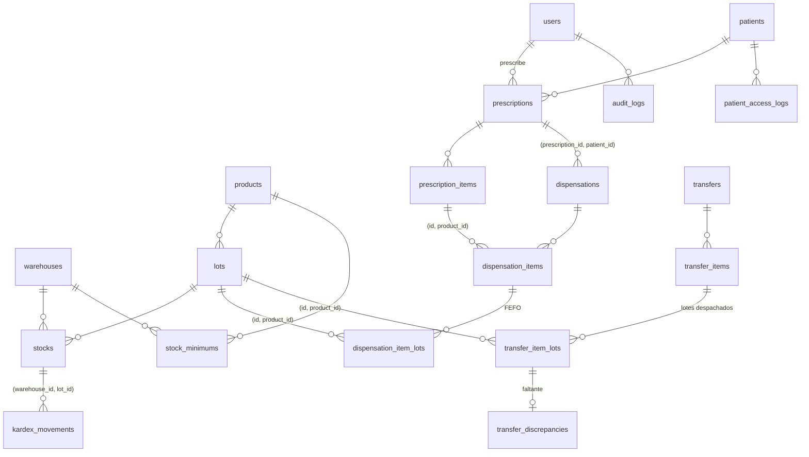

# Modelo de datos

PostgreSQL 16. Principio: **cada regla de negocio que se puede expresar en la BD se defiende en la BD** (CHECK, UNIQUE, FK, triggers), además de en el código. Así un bug en un servicio, un script manual o una condición de carrera no pueden dejar datos inválidos.

## Diagrama

## Tablas y defensas en BD

| Tabla | Defensas | Regla |
|---|---|---|
| `users` | `role` CHECK en los 5 roles; `must_change_password` (contraseña temporal asignada por el admin, S-77) | §5 |
| `warehouses`, `products` | `code` UNIQUE y no vacío | — |
| `lots` | UNIQUE `(product_id, lot_number)`; UNIQUE `(id, product_id)` como destino de FK compuestas; índice `(product_id, expires_at, id)` para FEFO | RN-01, RN-02 |
| `stocks` | `quantity >= 0`; UNIQUE `(warehouse_id, lot_id)`; FK compuesta `(lot_id, product_id) → lots`; índice parcial `WHERE quantity > 0` | RN-01, RN-03 |
| `stock_minimums` | `min_quantity >= 0`; UNIQUE `(warehouse_id, product_id)` | RN-11 |
| `kardex_movements` | `type` CHECK; `quantity > 0`; `direction IN (-1, 1)` y coherente con el tipo; `balance_after >= 0`; AJUSTE exige `reason` no vacío; FK `(warehouse_id, lot_id) → stocks`; FK `(lot_id, product_id) → lots`; triggers **`kardex_movements_append_only`** (bloquea UPDATE/DELETE) y `kardex_movements_check_balance` (AFTER INSERT: `balance_after` = existencia actual de `stocks`) | RN-06 |
| `patients` | `document_number` y `phone` cifrados (cast `encrypted`); `document_hash` HMAC UNIQUE; `document_type` CHECK | RN-10 |
| `prescriptions` | `status` CHECK; `valid_until >= issued_at` | RN-04 |
| `prescription_items` | `quantity_prescribed > 0`; `quantity_dispensed >= 0`; **`quantity_dispensed <= quantity_prescribed`**; UNIQUE `(prescription_id, product_id)` | RN-04 |
| `dispensations` | `status` CHECK; `idempotency_key` UNIQUE; **`authorized_by <> created_by`**; controlado COMPLETADA ⇒ autorizado; RECHAZADA ⇒ quién/cuándo/motivo; FK `(prescription_id, patient_id)`; triggers `dispensations_check_roles` (quien autoriza/rechaza es `regente_farmacia` activo) y `dispensations_check_items_consistency` (no apagar `requires_authorization` ni cambiar de prescripción dejando líneas incoherentes) | RN-04, RN-05, RN-09 |
| `dispensation_items` / `dispensation_item_lots` | cantidades `> 0`; FK compuestas que obligan a que el lote sea del producto prescrito; trigger `dispensation_items_check_integrity`: la línea de prescripción pertenece a la prescripción de la cabecera y un producto `is_controlled` exige `requires_authorization = true`; trigger **`dispensation_item_lots_check_lot`** (BEFORE INSERT): un lote con `expires_at < business_today()` no se dispensa | RN-01, RN-02, RN-04, RN-05 |
| `transfers` | `status` CHECK (7 estados); origen ≠ destino; **`approved_by <> requested_by`**; cada estado exige sus actores/fechas; ANULADO solo sin `dispatched_at` y con motivo no vacío (`transfers_cancel_reason_required`); triggers `transfers_check_roles` (quien aprueba es `regente_farmacia` activo) y **`transfers_check_transition`** (solo los pares de `TransferStateMachine`, incluida la diagonal prohibida, S-64) | RN-07, RN-08 |
| `transfer_items` / `transfer_item_lots` | cantidades `> 0`; `0 <= quantity_received <= quantity_dispatched`; FK compuestas lote/producto; triggers `transfer_items_only_in_draft` (líneas solo en BORRADOR), **`transfer_item_lots_check_lot`** (BEFORE INSERT: no despachar un lote vencido) y `transfer_item_lots_freeze` (lo despachado no cambia; `quantity_received` se escribe una vez) | RN-01, RN-07 |
| `transfer_discrepancies` | `quantity_missing > 0`; `status` CHECK; RESUELTA ⇒ resolución, quién y cuándo; `resolution_action` ∈ (`REINTEGRAR_ORIGEN`, `PERDIDA`) y obligatoria solo si RESUELTA; triggers `transfer_discrepancies_check_roles` (quien resuelve es `regente_farmacia` activo, S-50), `transfer_discrepancies_check_resolver` (no lo resuelve quien recibió, S-60), `transfer_discrepancies_check_missing` (faltante = despachado − recibido) y `transfer_discrepancies_freeze_resolved` (una RESUELTA no cambia) | RN-07 |
| `patient_access_logs`, `audit_logs` | triggers **`patient_access_logs_append_only`** y **`audit_logs_append_only`**; solo IDs (sin PII). `patient_access_logs.action` CHECK en (`patient.search`, `patient.view`, `patient.prescriptions`, `patient.dispensation_view`) y `masked` (si se vio enmascarado) | RN-10 |

Funciones compartidas: `forbid_append_only_mutation()` y `assert_user_role()` (migración `create_db_guard_functions`; desde `add_transfer_lot_integrity_guards` exige además `is_active`, S-66) y `business_today()` = fecha de Bogotá, único lugar del SQL con la zona horaria (migración `add_dispensation_lot_expiry_guard`, S-65).

Son 17 triggers propios (`select tgname, tgrelid::regclass from pg_trigger where not tgisinternal`). Ninguno frena `TRUNCATE` (triggers de fila): por eso la API corre con el rol `fartmar_app`, sin `TRUNCATE`, DDL ni `TRIGGER`, y con solo `SELECT/INSERT` en kardex y bitácoras (S-101).

## Lo que la BD NO garantiza (lo hace el código en `app/Domain`)

Ya se defienden en la BD (además del código): lote vencido en dispensación y en traslado, `balance_after` igual a la
existencia, pasos de la máquina de estados del traslado y que quien aprueba, autoriza, rechaza o resuelve sea un regente
**activo**. Lo que la BD **no** valida:

- **FEFO**: el orden de consumo de lotes lo decide `FefoAllocator`; la BD acepta cualquier lote no vencido del producto.
- **Vigencia de la prescripción** (`ACTIVA` y `valid_until >= hoy`) al dispensar: la valida `DispenseService`.
- **Transiciones de la dispensación** (`PENDIENTE_AUTORIZACION → COMPLETADA | RECHAZADA`): solo hay CHECK sobre la fila
  resultante (quién autoriza o rechaza y con qué datos), no sobre el paso.
- Que una dispensación `PENDIENTE_AUTORIZACION` **no tenga lotes** en `dispensation_item_lots` (ni que una COMPLETADA
  los tenga): ningún trigger mira el estado de la cabecera.
- Un **`INSERT` de un traslado en estado avanzado** (p. ej. directamente `EN_TRANSITO`): el trigger de transición solo
  mira `UPDATE` de `status` (S-64).
- Que quien **crea** la dispensación o **solicita** el traslado esté activo (lo exigen las Policies, S-37).

## Usuarios de demo (solo demo con `SEED_DEMO_DATA=true`, nunca en producción)

Contraseña de todos: `password`.

| Email | Rol |
|---|---|
| admin@fartmar.test | admin |
| regente@fartmar.test | regente_farmacia |
| regente2@fartmar.test | regente_farmacia (segundo regente para RN-05 / RN-08) |
| auxiliar@fartmar.test | auxiliar_farmacia |
| medico@fartmar.test | medico |
| auditor@fartmar.test | auditor |
